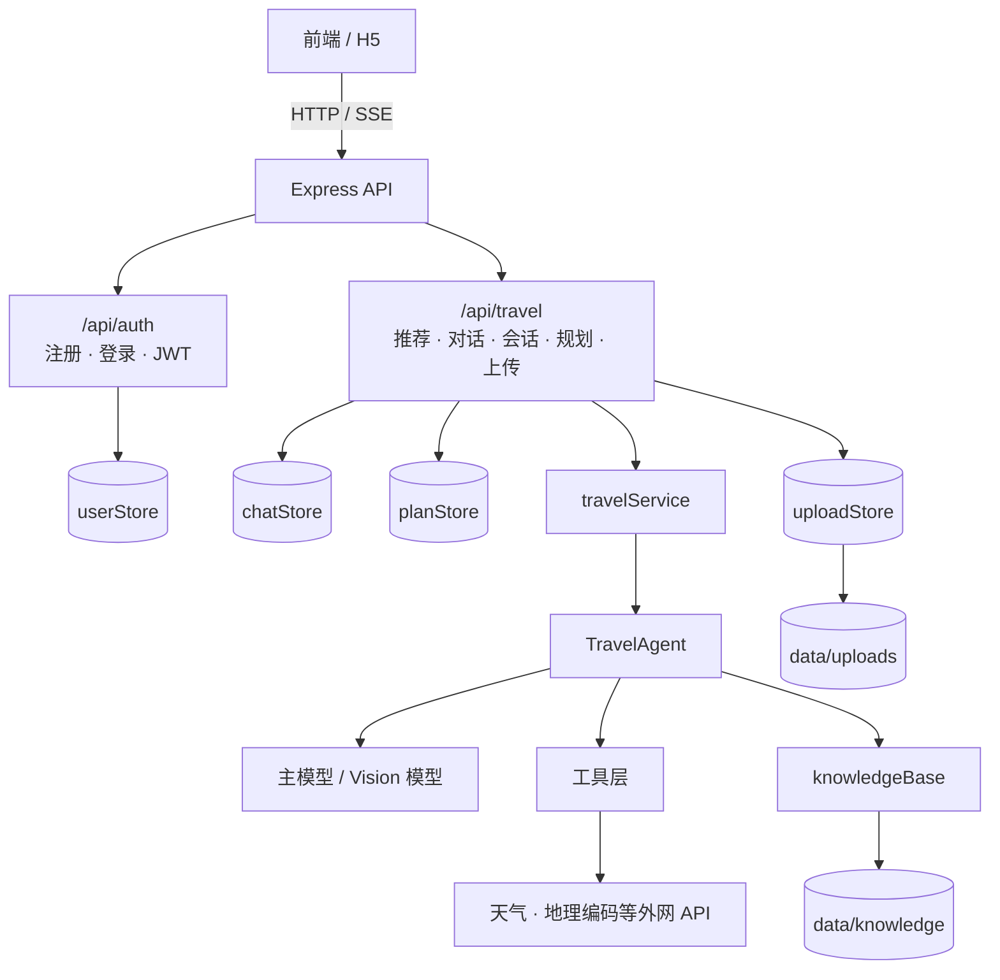
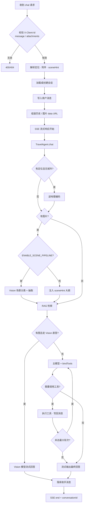
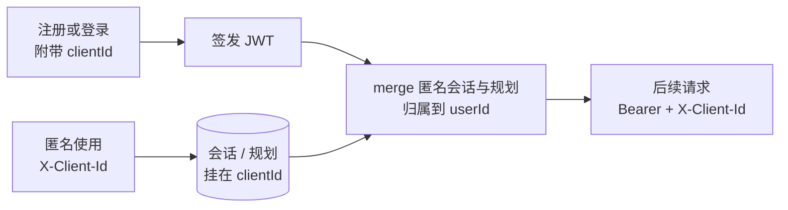

# travel-server

基于 **Express + TypeScript + LangChain** 的旅行推荐后端。对接兼容 OpenAI 协议的大模型（默认硅基流动），使用 **SQLite** 持久化用户、会话、行程与上传图片，并为前端提供行程规划、流式 AI 对话与多模态场景识别能力。

## 功能概览

- **行程推荐**：按城市、预算、天数生成规划并落库，支持「规划记录」查询
- **流式 AI 对话**：TravelAgent + 工具调用 + 本地 RAG 知识库，SSE 流式返回
- **多模态场景**：识景点指示牌、门票/行程单、菜单（Vision 分类与抽取）
- **账号体系**：手机号 / 邮箱注册登录，JWT 鉴权；匿名 `X-Client-Id` 数据可在登录后合并
- **会话管理**：对话创建、重命名、置顶、删除与详情查询
- **图片上传**：JPEG / PNG / WebP，单文件最大 5MB

## 技术栈

| 类别 | 选型 |
|------|------|
| 运行时 | Node.js、Express、TypeScript |
| AI | LangChain、`@langchain/openai`（SiliconFlow 等） |
| 存储 | better-sqlite3 |
| 认证 | JWT、bcryptjs |
| 上传 | multer、image-size |

## 目录结构

```
src/
  agent/         # TravelAgent、工具、场景识别、系统提示词
  db/            # SQLite：用户 / 会话 / 规划 / 上传
  rag/           # 本地知识库检索
  routes/        # auth、travel、recommend（流式规划）
  service/       # 业务编排、LLM、recommendStream
  middleware/    # JWT 鉴权、统一 errorHandler
  utils/         # SSE、上下文窗口、plan JSON 解析、LLM 错误
  index.ts       # 入口
data/
  knowledge/     # RAG 文档（按城市 Markdown）
  uploads/       # 上传图片（运行时）
  *.db           # SQLite 数据文件（运行时）
evals/           # Agent 评测用例
scripts/         # 评测脚本
Dockerfile       # 多阶段构建；entrypoint 首次 seed 知识库
```

## 流程图

### 系统架构



### 流式对话 `/api/travel/chat`



### 登录合并匿名数据



## 快速开始

### 1. 环境要求

- Node.js 18+
- npm

### 2. 安装与配置

```bash
cp .env.example .env
npm install
```

在 `.env` 中至少配置：

| 变量 | 说明 |
|------|------|
| `PORT` | 服务端口，默认 `5000` |
| `MODEL_PROVIDER` | 模型提供方前缀，如 `SILICONFLOW` |
| `SILICONFLOW_API_KEY` | API Key |
| `SILICONFLOW_BASE_URL` | 兼容 OpenAI 的 Base URL |
| `SILICONFLOW_MODEL` | 主对话模型 |
| `SILICONFLOW_VISION_MODEL` | 多模态 / Vision 模型（需支持视觉） |
| `JWT_SECRET` | JWT 签名密钥（未设置时 auth 路由不可用） |
| `JWT_EXPIRES_IN` | Token 有效期，默认 `7d` |

可选：

- `ATTACH_IMAGES_TO_CHAT=1`：最终对话轮把原图一并发给主模型（主模型需支持视觉）
- `ENABLE_SCENE_PIPELINE=1`：有图时先跑 Vision「分类 + 抽取」；默认关闭，直接把原图交给 Vision 模型回答
- `NOMINATIM_USER_AGENT`：Nominatim 回退请求的 User-Agent（默认 `travel-recommend-h5/1.0`）

### 3. 启动

```bash
npm run dev          # 开发：tsx watch
npm run build        # 编译到 dist/
npm start            # 生产：node dist/index.js
```

默认地址：`http://localhost:5000`

### 4. 评测

```bash
npm run eval              # 默认 EVAL_DRY_TOOLS=1：工具打桩，无需外网天气/地理 API
EVAL_DRY_TOOLS=0 npm run eval   # 真实调用工具（需外网）
```

- 用例：`evals/travel-agent.eval.json`（期望工具、关键词、是否要求 RAG 命中）
- 脚本：`scripts/run-eval.ts` → 调 `travelService.chat`，汇总 pass/fail
- 仍需要可用的主模型配置（`.env` 中 `MODEL_PROVIDER` / API Key 等）

## 数据归属（Owner）

旅行域多数 REST / 上传 / 对话接口经 `optionalAuth` + `resolveOwner`（`src/routes/travel.ts`）：

| 请求头 | 作用 |
|--------|------|
| `X-Client-Id`（必填） | 匿名设备标识；缺则 400 |
| `Authorization: Bearer`（可选） | 合法 JWT 时 `userId` 写入 owner |

查询规则（`chatStore` / `planStore` / `uploadStore`）：**有 `userId` 按用户查；否则按 `clientId` 且 `user_id IS NULL`**。登录/注册若 body 带 `clientId`，会把该匿名会话与规划 `UPDATE` 到正式 `user_id`（返回 `mergedConversations` / `mergedPlans`）。

例外：`POST /recommend` 不强制 `X-Client-Id`；有则落库并在 `done` 带 `id`，无则只流式返回不持久化。

## API 一览

### 通用

| 方法 | 路径 | 说明 |
|------|------|------|
| `GET` | `/` | 健康探活文案 |
| `GET` | `/api/heartbeat` | `{ status, timestamp }` |

### 认证 `/api/auth`

| 方法 | 路径 | 说明 |
|------|------|------|
| `POST` | `/register` | 注册；body: `account`, `password`, 可选 `nickname` / `clientId` |
| `POST` | `/login` | 登录；可带 `clientId` 合并匿名数据 |
| `GET` | `/me` | 当前用户（需 Bearer Token） |
| `POST` | `/logout` | 登出（服务端无状态；客户端丢弃 Token 即可） |

约束：`account` 为大陆手机号（`1` + 10 位）或邮箱；邮箱存小写；密码 ≥ 6 位；未设 `JWT_SECRET` 时鉴权路由不可用。

### 旅行 `/api/travel`

多数接口需要请求头 **`X-Client-Id`**。登录后可额外携带：

```http
Authorization: Bearer <token>
```

| 方法 | 路径 | 说明 |
|------|------|------|
| `POST` | `/recommend` | **SSE** 行程规划（body: `city`, `budget`, `days`） |
| `POST` | `/chat` | **SSE** 流式对话（`message`、`conversationId`、`location`、`attachments`、`sceneHint`） |
| `GET` | `/conversations` | 会话列表 |
| `POST` | `/conversations` | 新建会话 |
| `GET` | `/conversations/:id` | 会话详情（含消息） |
| `PATCH` | `/conversations/:id` | 重命名 / 置顶 |
| `DELETE` | `/conversations/:id` | 删除会话 |
| `GET` | `/plans` | 规划记录列表 |
| `GET` | `/plans/:id` | 规划详情 |
| `DELETE` | `/plans/:id` | 删除规划 |
| `POST` | `/uploads/image` | 上传聊天图片（multipart field: `file`） |
| `GET` | `/uploads/files/:id` | 读取已上传图片 |
| `GET` | `/location/reverse` | 逆地理编码（query: `lat`, `lon`） |

#### 约束

| 接口 | 约束 |
|------|------|
| `/recommend` | `days` 1–30；`budget` ≥ 100；缺字段返回 400 JSON（非 SSE） |
| `/chat` | `message` 与 `attachments` 至少其一；附件最多 3 张，且须属当前 owner |
| `/uploads/image` | JPEG / PNG / WebP；单文件 ≤ 5MB |
| `/location/reverse` | query `lat`/`lon` 须为有限数字；纬度 ∈ [-90,90]，经度 ∈ [-180,180] |
| `/conversations` PATCH | body 至少含 `title`（string）或 `pinned`（boolean）之一 |

#### 会话列表与 PATCH

`GET /conversations` 返回当前 owner 的摘要列表，SQL 排序：`pinned DESC, updated_at DESC`。每项含：

| 字段 | 说明 |
|------|------|
| `id` / `title` / `pinned` | 会话标识、标题、是否置顶 |
| `updatedAt` | 毫秒时间戳 |
| `preview` | 最近一条消息：非空文本，否则有附件显示 `[图片]`，否则 `""` |

`PATCH /conversations/:id`（`src/routes/travel.ts` + `chatStore`）：

| 字段 | 类型 | 行为 |
|------|------|------|
| `title` | string | trim + 压缩空白；空串 → 400 `Title cannot be empty`；截断至 **40** 字（尾部 `…`） |
| `pinned` | boolean | `true`/`false` 写入 `pinned` 列（1/0）；不更新 `updated_at` |

两者都缺 → 400 `Nothing to update`；会话不存在 → 404。成功响应：

```json
{ "status": "ok", "data": { "id": "...", "title": "...", "pinned": true, "updatedAt": 0 } }
```

说明：首轮自动生成标题走 `truncateTitle` 默认上限 **20** 字；手动重命名上限 **40** 字。`POST /conversations` 默认标题为「新对话」，响应不含 `pinned`（恒为未置顶）。

#### 逆地理编码 `GET /location/reverse`

实现：`reverseGeocode`（`src/agent/tools.ts`）。需 `X-Client-Id`。

成功 `200`：

```json
{
  "status": "ok",
  "data": {
    "lat": 39.9042,
    "lon": 116.4074,
    "city": "北京",
    "displayName": "..."
  }
}
```

| 步骤 | 说明 |
|------|------|
| 主路径 | BigDataCloud `reverse-geocode-client`，`localityLanguage=zh` |
| 回退 | Nominatim `/reverse`（`zoom=10`，User-Agent 见 `NOMINATIM_USER_AGENT`） |
| 城市归一 | 去掉「市/地区/特别行政区」后缀；若干繁体字转简体；空则 `"当前位置"` |
| 超时 | 外网请求统一 `8000ms`（`FETCH_TIMEOUT_MS`） |
| 评测 | `dryTools` 时返回固定「模拟城市」，不打外网 |

错误：

| HTTP | 条件 |
|------|------|
| 400 | 缺/非法 `lat`/`lon`，或越界 |
| 502 | 主路径与 Nominatim 均失败；`message` 多为主路径错误文案 |

国内常见：Nominatim 超时或不可达——属预期，主路径应优先成功；两者都失败时前端应降级为仅用经纬度。

#### SSE 约定

两条流式接口均返回 `Content-Type: text/event-stream`，每条事件一行 `data: <json>\n\n`（见 `src/utils/streamUtils.ts`）。设置了 `X-Accel-Buffering: no` 以便反代实时推送。客户端断开时会 `AbortController.abort()` 取消 LLM。

**`POST /recommend` 事件**（实现：`src/routes/recommend.ts` + `recommendStream.ts`）：

| `type` | 含义 |
|--------|------|
| `stage` | 心跳 / 阶段，内容多为 `"generating"`（约每 3s） |
| `meta` | 部分解析出的 `{ city, days, totalBudget }` |
| `day` | 某一天行程（按 day 号去重推送） |
| `budget` | 预算拆分（`budgetBreakdown` 对象） |
| `done` | 完整规划 JSON；若带了 `X-Client-Id` 会落库并带上 `id` |
| `error` | 失败；可能含 `code`（如 `RATE_LIMITED`、`PARSE_FAILED`）与 `retryAfter` |

增量推送条件（`planPartialParse.ts`）：`day` 须同时具备 `day` 数字与 `morning` / `afternoon` / `evening`（且各段 `spot` 非空）才发出；`budget` 在 `budgetBreakdown` 对象完整闭合后发出一次。

**规划 JSON 字段**（提示词约定：`recommendPrompt.ts`；H5 类型：`TravelPlan`）：

```json
{
  "success": true,
  "city": "城市名",
  "days": 3,
  "totalBudget": 3000,
  "dailyItinerary": [
    {
      "day": 1,
      "date": "第1天",
      "morning": {
        "spot": "景点名",
        "duration": "游览时长",
        "ticket": "门票",
        "transportation": "交通",
        "description": "介绍"
      },
      "afternoon": { "...": "同上" },
      "evening": { "...": "同上" }
    }
  ],
  "budgetBreakdown": {
    "accommodation": 0,
    "food": 0,
    "transportation": 0,
    "tickets": 0,
    "other": 0
  },
  "tips": ["..."],
  "warnings": ["..."]
}
```

| 字段 | 说明 |
|------|------|
| `success` | `false` 时 SSE 以 `PARSE_FAILED` 结束，消息取 `message` |
| `dailyItinerary[].day` | 按 day 号去重；前端 `mergePlanEvent` 按同号覆盖 |
| `budgetBreakdown` | 五类费用数字；对应 SSE `budget` 事件的 `content` |
| `id` | 仅持久化后出现在 `done`（有 `X-Client-Id` 时） |

**`POST /chat` 事件**：

| `type` | 载荷 |
|--------|------|
| `chunk` | `content`: 增量文本 |
| `done` | `content`: `{ conversationId, content, usage }` |
| `error` | `message`（字符串） |

`done.content.usage`（启发式估算，见 `prepareChatContext` / `tokenCounter.ts`）：

| 字段 | 含义 |
|------|------|
| `estimatedInputTokens` | 本轮估算输入总量（含当前消息） |
| `historyBeforeTokens` | 压缩 / 滑动前历史 token |
| `historyAfterTokens` | 压缩 / 滑动后送入 Agent 的历史 token |
| `keptMessages` | 保留的历史条数 |
| `droppedMessages` | 滑出窗口的条数 |
| `summarized` | 是否对滑出消息做了摘要压缩 |

H5 当前消费 `conversationId` / `content`，不展示 `usage`；字段仍可用于排障与评测。

#### 常见 API 错误（REST，非 SSE）

| 场景 | HTTP | `message` 示例 |
|------|------|----------------|
| 缺 `X-Client-Id` | 400 | `Missing required header: X-Client-Id` |
| `/recommend` 缺字段 | 400 | `Missing required fields`（JSON，未进 SSE） |
| `/chat` 无文无图 | 400 | `Missing required field: message or attachments` |
| 附件非本人 / 不存在 | 400 | `Invalid attachment: <id>`（`getOwnedUpload`） |
| 附件文件读失败 | 500 | `Failed to read attachment` |
| 上传缺 `file` | 400 | `Missing file field: file` |
| MIME 非 JPEG/PNG/WebP | 400 | `仅支持 JPEG / PNG / WebP 图片` |
| 上传 > 5MB | 400 | `图片过大，最大 5MB` |
| 读上传文件 404 | 404 | `File not found`（`GET /uploads/files/:id` 无鉴权，靠 UUID 不透明） |
| 逆地理缺/非法坐标 | 400 | `Missing or invalid query: lat, lon` / `lat/lon out of range` |
| 逆地理上游失败 | 502 | 外网超时或供应商错误原文 |
| PATCH 无有效字段 | 400 | `Nothing to update` |
| PATCH 空标题 | 400 | `Title cannot be empty` |
| 会话 / 规划不存在 | 404 | `Conversation not found` / `Plan not found` |

归属：登录用户按 `user_id`；匿名按 `client_id` 且 `user_id IS NULL`。登录后引用登录前匿名上传的 id 会 `Invalid attachment`。

#### 对话场景 Hint

`sceneHint` 可选值：

- `spot_sign` — 景点指示牌
- `ticket_itinerary` — 门票 / 行程单
- `food_menu` — 菜单

默认有图时把原图交给 Vision 模型直答；仅当 `ENABLE_SCENE_PIPELINE=1` 时才走「分类 + 结构化抽取」再注入上下文。

## Agent 与工具

对话由 `TravelAgent` 编排（`createTravelTools`），工具结果统一为 JSON 字符串：`{ ok: true, data }` 或 `{ ok: false, tool, error }`。`EVAL_DRY_TOOLS=1` / `dryTools` 时天气与地理走桩数据。

| 工具 | 参数（Zod） | 行为要点 |
|------|-------------|----------|
| `get_weather` | `city?` string；`lat?`/`lon?` number；`days?` int 1–7（默认 3） | 缺坐标时用 `geocodePlace(city)`；只有坐标时反查城市名。数据源 Open-Meteo；返回 `current` + `daily[]`（气温/天气码文案/降水） |
| `geocode_location` | `query` string（必填） | 地名 → `{ lat, lon, displayName }`。优先 Open-Meteo，失败回退 Nominatim |
| `search_attractions` | `city` string；`keyword?` string | 本地 RAG，`type=attraction`，`topK=4`；无命中带 `note` |
| `search_travel_guides` | `query` string；`city?` string | 本地 RAG，`type=guide`，`topK=4`；另含 `resultsText` 便于拼进提示词 |

地理编码策略与 HTTP 逆地理互补：正向编码偏 Open-Meteo；逆地理偏 BigDataCloud。外网超时均为 8s。

## 知识库（RAG）

路径：`data/knowledge/*.md`。启动时（及 Docker entrypoint seed 后）按文件加载；按 `##` 二级标题切成 chunk，进程内缓存（改文件后需重启或 `loadKnowledgeChunks(true)`）。

Frontmatter 示例：

```markdown
---
city: 北京
type: both          # attraction | guide | both
tags: 故宫,长城,颐和园
---

# 北京旅游攻略

## 必去景点：故宫博物院
...
## 游玩攻略与交通
...
```

- `type: both` 时，标题含「景点|必去」偏 attraction，「攻略|交通|美食|住宿|游玩」偏 guide
- 检索：中英 token + 城市软过滤；工具与 system RAG 注入共用（见 `src/rag/knowledgeBase.ts`）
- 新增城市：在该目录加 Markdown → 本地重启；Docker 需更新镜像或挂载覆盖 volume（空 volume 仅首次从 seed 拷贝）

## 上下文窗口（Token 预算）

对话在进入 Agent 前会走 `prepareChatContext`：

1. **启发式 Token 估算**（中英混合，见 `src/utils/tokenCounter.ts`）
2. **滑动窗口**：从最新消息向前填满输入预算
3. **摘要压缩**（默认开启）：被滑出的旧消息经 LLM 压成短摘要再注入

相关环境变量见 `.env.example`（`CONTEXT_MAX_TOKENS` 等）。SSE `done` 事件的 `content.usage` 会带回估算统计。

## Docker

本仓库仅含后端镜像（无 `docker-compose.yml`）。知识库在镜像内作为 `knowledge-seed`；命名卷首次挂载空的 `/app/data/knowledge` 时，`docker-entrypoint.sh` 会拷贝 seed。

```bash
# 构建
docker build -t travel-server .

# 运行（持久化 SQLite / 上传 / 知识库）
docker run --rm -p 5000:5000 \
  --env-file .env \
  -v travel-server-data:/app/data \
  travel-server
```

健康检查探测 `GET /api/heartbeat`。与前端联调时：H5 镜像的 Nginx 把 `/api/` 反代到主机名 `server:5000`（见 `travel-agent-H5` 的 `nginx.conf`），Compose 中请把本服务命名为 `server`，并为 SSE 关闭缓冲、拉长超时。

## 故障排查

| 现象 | 排查 |
|------|------|
| 注册 / 登录 500 或不可用 | 未设置 `JWT_SECRET`（启动时会打 warn） |
| `/recommend` 立刻 400 JSON | 缺 `city` / `budget` / `days`，尚未进入 SSE |
| 规划 `RATE_LIMITED` | 上游 LLM 限流；事件带 `retryAfter`，前端会倒计时重试 |
| 规划 `PARSE_FAILED` | 模型输出非预期 JSON；重试或检查主模型是否适合结构化输出 |
| 对话无场景抽取 | 默认未开管线；需要时设 `ENABLE_SCENE_PIPELINE=1` 且配置可用的 Vision 模型 |
| `/location/reverse` 502 | BigDataCloud 与 Nominatim 均失败；查出站网络 / 超时（8s）；Nominatim 可用 `NOMINATIM_USER_AGENT` |
| 会话 PATCH 400 | 确认 body 有 `title` 字符串或 `pinned` 布尔；标题勿全空白 |
| 列表排序不符合预期 | 服务端按置顶优先再按 `updated_at`；置顶本身不刷新 `updated_at` |
| Docker 知识库为空 | 确认 volume 首次为空从而触发 seed；或手动挂载 `data/knowledge` |
| better-sqlite3 本地编译失败 | 需本机 Python / make / g++；Docker 构建已在 builder 阶段安装 |

