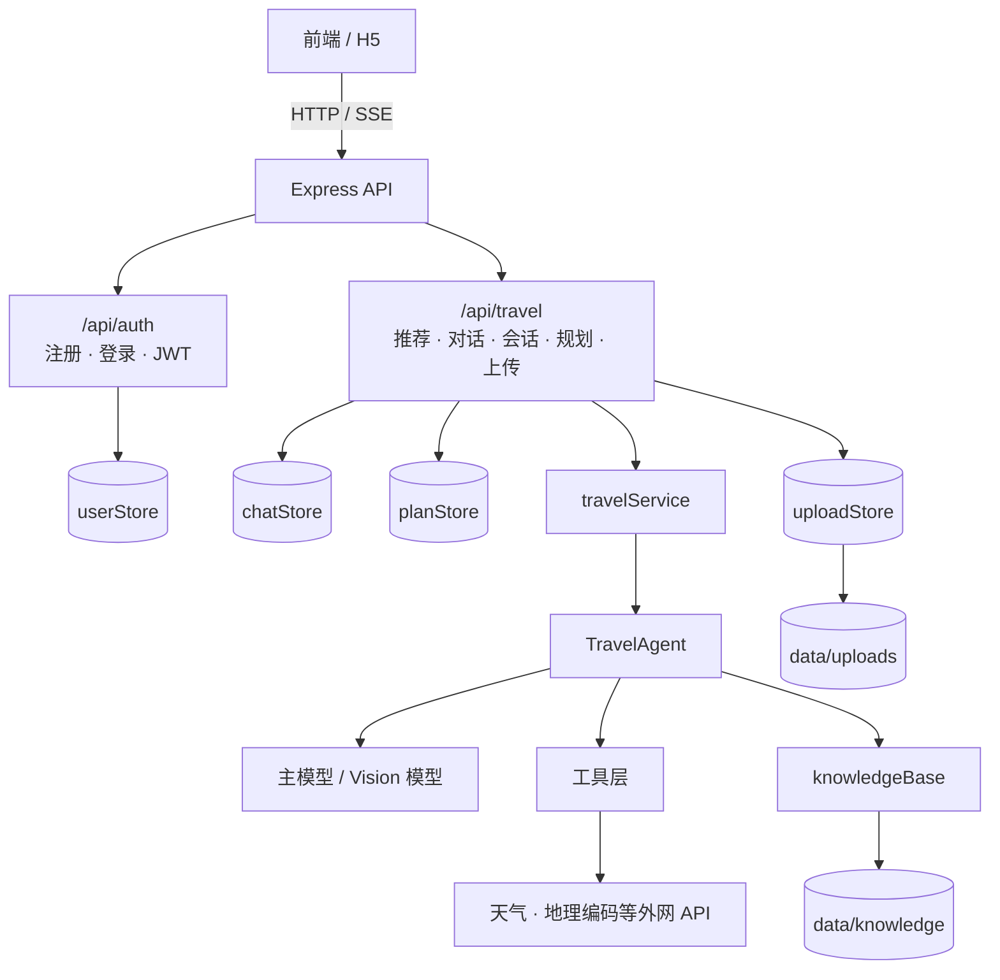
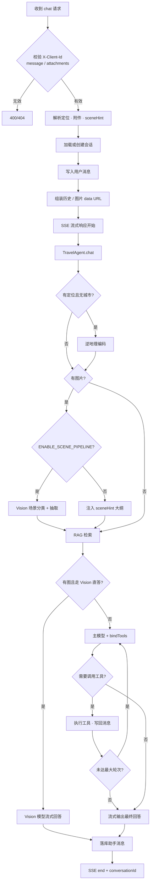
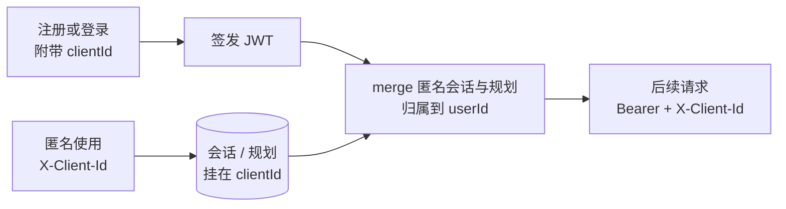

# travel-server

基于 **Express + TypeScript + LangChain** 的旅行推荐后端。对接兼容 OpenAI 协议的大模型（默认硅基流动），使用 **SQLite** 持久化用户、会话、行程与上传图片，并为前端提供行程规划、流式 AI 对话与多模态场景识别能力。

## 功能概览

- **行程推荐**：按城市、预算、天数生成规划并落库，支持「规划记录」查询
- **流式 AI 对话**：TravelAgent + 工具调用 + 本地 RAG 知识库，SSE 流式返回
- **多模态场景**：识景点指示牌、门票/行程单、菜单（Vision 分类与抽取）
- **账号体系**：手机号 / 邮箱注册登录，JWT 鉴权；匿名 `X-Client-Id` 数据可在登录后合并
- **会话管理**：对话创建、重命名、置顶、删除与详情查询
- **图片上传**：JPEG / PNG / WebP，单文件最大 5MB

## 技术栈

| 类别 | 选型 |
|------|------|
| 运行时 | Node.js、Express、TypeScript |
| AI | LangChain、`@langchain/openai`（SiliconFlow 等） |
| 存储 | better-sqlite3 |
| 认证 | JWT、bcryptjs |
| 上传 | multer、image-size |

## 目录结构

```
src/
  agent/         # TravelAgent、工具、场景识别、系统提示词
  db/            # SQLite：用户 / 会话 / 规划 / 上传
  rag/           # 本地知识库检索
  routes/        # auth、travel、recommend（流式规划）
  service/       # 业务编排、LLM、recommendStream
  middleware/    # JWT 鉴权、统一 errorHandler
  utils/         # SSE、上下文窗口、plan JSON 解析、LLM 错误
  index.ts       # 入口
data/
  knowledge/     # RAG 文档（按城市 Markdown）
  uploads/       # 上传图片文件（运行时）
  chat.db        # 用户 / 会话 / 消息 / 上传元数据（WAL）
  plans.db       # 行程规划记录（WAL）
evals/           # Agent 评测用例
scripts/         # 评测脚本
Dockerfile       # 多阶段构建；entrypoint 首次 seed 知识库
```

持久化约定（对照 `src/db/*`）：`chat.db` 由 `userStore` / `chatStore` / `uploadStore` 共用；`plans.db` 独立；均开启 `journal_mode=WAL` 与 `foreign_keys=ON`。Docker 把 `/app/data` 挂卷即可一并持久化库与上传。

## 流程图

### 系统架构



### 流式对话 `/api/travel/chat`



### 登录合并匿名数据



合并范围仅限 **会话**（`mergeAnonymousConversations`）与 **规划**（`mergeAnonymousPlans`）。上传附件不合并：匿名期 `user_id IS NULL` 的图片登录后仍属匿名 owner，续聊引用旧 `attachments[].id` 会 `Invalid attachment`，需重新上传。

## 快速开始

### 1. 环境要求

- Node.js 18+
- npm

### 2. 安装与配置

```bash
cp .env.example .env
npm install
```

在 `.env` 中至少配置：

| 变量 | 说明 |
|------|------|
| `PORT` | 服务端口，默认 `5000` |
| `MODEL_PROVIDER` | 模型提供方前缀，如 `SILICONFLOW` |
| `SILICONFLOW_API_KEY` | API Key |
| `SILICONFLOW_BASE_URL` | 兼容 OpenAI 的 Base URL |
| `SILICONFLOW_MODEL` | 主对话模型 |
| `SILICONFLOW_VISION_MODEL` | 多模态 / Vision 模型（需支持视觉；见下方解析顺序） |
| `JWT_SECRET` | JWT 签名密钥（未设置时 auth 路由不可用） |
| `JWT_EXPIRES_IN` | Token 有效期，默认 `7d` |

Vision 模型解析顺序（`initVisionLLM`）：`${MODEL_PROVIDER}_VISION_MODEL` → 通用 `VISION_MODEL` → 回退 `${MODEL_PROVIDER}_MODEL`（未配 VL 时与主模型相同，有图对话会退化）。

可选：

- `FORCE_TEXT_CHAT_WITH_IMAGES=1`：有图时强制走主模型文本路径（默认把原图交给 Vision 模型流式直答，不绑工具）
- `ENABLE_SCENE_PIPELINE=1`：有图时先跑 Vision「分类 + 抽取」；默认关闭，直接把原图交给 Vision 模型回答
- `NOMINATIM_USER_AGENT`：Nominatim 回退请求的 User-Agent（默认 `travel-recommend-h5/1.0`）
- `VISION_MODEL`：跨 provider 的 Vision 模型名（仅当未设 `${PROVIDER}_VISION_MODEL` 时生效）

### 3. 启动

```bash
npm run dev          # 开发：tsx watch
npm run build        # 编译到 dist/
npm start            # 生产：node dist/index.js
```

默认地址：`http://localhost:5000`

### 4. 评测

```bash
npm run eval              # 默认 EVAL_DRY_TOOLS=1：工具打桩，无需外网天气/地理 API
EVAL_DRY_TOOLS=0 npm run eval   # 真实调用工具（需外网）
```

- 用例：`evals/travel-agent.eval.json`
- 脚本：`scripts/run-eval.ts` → 调 `travelService.chat`，汇总 pass/fail；任一例失败则 `exitCode=1`
- 仍需要可用的主模型配置（`.env` 中 `MODEL_PROVIDER` / API Key 等）
- `EVAL_DRY_TOOLS`：未设或非 `0` 时工具打桩；仅 `EVAL_DRY_TOOLS=0` 走真实外网工具

用例字段（`EvalCase`）：

| 字段 | 含义 |
|------|------|
| `id` / `query` | 用例名与用户问题 |
| `expectTools` | 必须全部出现在 `toolTrace`；`[]` 表示期望尽量无工具（软约束，除非另有 `forbidTools`） |
| `expectToolsAny` | 至少命中其一；若同时 `acceptRagWithoutTools` 且 RAG 有命中，可豁免 |
| `forbidTools` | 出现即失败 |
| `expectKeywordsAny` | 回答文本至少命中一个关键词 |
| `requireRag` | 为 `true` 时 `retrieveKnowledge(query, topK=3)` 必须有命中 |

## 数据归属（Owner）

旅行域多数 REST / 上传 / 对话接口经 `optionalAuth` + `resolveOwner`（`src/routes/travel.ts`）：

| 请求头 | 作用 |
|--------|------|
| `X-Client-Id`（必填） | 匿名设备标识；缺则 400 |
| `Authorization: Bearer`（可选） | 合法 JWT 时 `userId` 写入 owner |

查询规则（`chatStore` / `planStore` / `uploadStore`）：**有 `userId` 按用户查；否则按 `clientId` 且 `user_id IS NULL`**。登录/注册若 body 带 `clientId`，会把该匿名会话与规划 `UPDATE` 到正式 `user_id`（返回 `mergedConversations` / `mergedPlans`）。

例外：`POST /recommend` 不强制 `X-Client-Id`；有则落库并在 `done` 带 `id`，无则只流式返回不持久化。

### 鉴权中间件与 JWT

| 中间件 | 行为 |
|--------|------|
| `optionalAuth` | 有合法 Bearer 则挂 `req.user`；无效 / 缺省继续匿名（不 401） |
| `requireAuth` | 缺 Token → `401 Unauthorized`；无效/过期 → `401 Invalid or expired token` |

JWT（`src/utils/jwt.ts`）：payload 为 `{ sub: userId, account }`；校验后挂到中间件的 `AuthUser` 仅 `{ id, account }`（无 nickname）。`JWT_EXPIRES_IN` 默认 `7d`；未设 `JWT_SECRET` 时签发/校验会抛错（auth 路由实际不可用）。旅行域走 `optionalAuth`；仅 `GET /api/auth/me` 强制 `requireAuth`。登录/注册/`/me` 响应里的 `user` 才是完整公开资料 `{ id, account, nickname, createdAt }`——勿把 JWT claims 与 API `user` 混为一谈。

### 统一错误处理

`src/middleware/errorHandler.ts` 挂在全部路由之后：

| 来源 | 客户端看到 |
|------|------------|
| `throw new HttpError(status, message)` | `{ status:"error", message }`，HTTP = status |
| Express / 中间件可暴露 4xx（`expose === true`） | 同上，原样 message |
| 其它未捕获异常 | 打日志；`500` + `服务异常，请稍后重试` |
| 已开始写响应（如 SSE） | 无法改状态码，仅 `res.end()` 断开 |

异步 handler 须包 `asyncHandler`，否则 Express 4 不会把 Promise reject 交给错误中间件。业务可预期错误优先在路由内直接 `res.status(4xx)`，与 `HttpError` 二选一即可。

## API 一览

### 通用

| 方法 | 路径 | 说明 |
|------|------|------|
| `GET` | `/` | 健康探活文案 |
| `GET` | `/api/heartbeat` | `{ status, timestamp }` |

### 认证 `/api/auth`

| 方法 | 路径 | 说明 |
|------|------|------|
| `POST` | `/register` | 注册；body: `account`, `password`, 可选 `nickname` / `clientId` |
| `POST` | `/login` | 登录；可带 `clientId` 合并匿名数据 |
| `GET` | `/me` | 当前用户（需 Bearer Token） |
| `POST` | `/logout` | 登出（服务端无状态；客户端丢弃 Token 即可） |

约束：`account` 为大陆手机号（`1` + 10 位）或邮箱；邮箱存小写；密码 ≥ 6 位；昵称可选、最长 20（缺省按手机后四位或邮箱前缀生成）；未设 `JWT_SECRET` 时鉴权路由不可用。Body 解析支持 `application/json` 与 `application/x-www-form-urlencoded`（见 `src/index.ts`）。

`POST /register` / `POST /login` 成功（`issueAuthResponse`，HTTP 200）：

```json
{
  "status": "ok",
  "data": {
    "token": "<jwt>",
    "user": { "id": "...", "account": "...", "nickname": "...", "createdAt": 0 },
    "mergedConversations": 0,
    "mergedPlans": 0
  }
}
```

有 `clientId` 时先 `mergeAnonymousConversations` / `mergeAnonymousPlans`，再签发 JWT；两计数字段为本次合并条数（无 `clientId` 则为 `0`）。**不合并 uploads**。`user` 不含密码哈希。

| 场景 | HTTP | `message` |
|------|------|-----------|
| 账号非法（注册） | 400 | `请输入有效的手机号或邮箱` |
| 密码 < 6（注册） | 400 | `密码至少 6 位` |
| 账号或密码格式不对（登录） | 400 | `账号或密码格式不正确` |
| 账号已存在 | 409 | `该账号已注册` |
| 账号不存在或密码错 | 401 | `账号或密码错误`（同一文案，防枚举） |
| `/me` 用户已删 | 401 | `用户不存在` |

`GET /me` 成功：`{ status: "ok", data: { id, account, nickname, createdAt } }`。`POST /logout`：`{ status: "ok" }`（`optionalAuth`，不强制登录）。

### 旅行 `/api/travel`

多数接口需要请求头 **`X-Client-Id`**。登录后可额外携带：

```http
Authorization: Bearer <token>
```

| 方法 | 路径 | 说明 |
|------|------|------|
| `POST` | `/recommend` | **SSE** 行程规划（body: `city`, `budget`, `days`） |
| `POST` | `/chat` | **SSE** 流式对话（`message`、`conversationId`、`location`、`attachments`、`sceneHint`） |
| `GET` | `/conversations` | 会话列表 |
| `POST` | `/conversations` | 新建会话 |
| `GET` | `/conversations/:id` | 会话详情（含消息） |
| `PATCH` | `/conversations/:id` | 重命名 / 置顶 |
| `DELETE` | `/conversations/:id` | 删除会话 |
| `GET` | `/plans` | 规划记录列表 |
| `GET` | `/plans/:id` | 规划详情 |
| `DELETE` | `/plans/:id` | 删除规划 |
| `POST` | `/uploads/image` | 上传聊天图片（multipart field: `file`） |
| `GET` | `/uploads/files/:id` | 读取已上传图片 |
| `GET` | `/location/reverse` | 逆地理编码（query: `lat`, `lon`） |

#### 约束

| 接口 | 约束 |
|------|------|
| `/recommend` | 缺 `city`/`budget`/`days` → **400 JSON**（尚未进 SSE）。`days` 不在 1–30 或 `budget` 小于 100 → **已开 SSE**（先发 `stage:generating`），再以 SSE `error` 返回文案（无 `code`） |
| `/chat` | `message` 与 `attachments` 至少其一；附件最多 3 张，且须属当前 owner；未知 `sceneHint` 静默忽略为 `null` |
| `/uploads/image` | JPEG / PNG / WebP；单文件 ≤ 5MB；multipart field 名必须为 `file` |
| `/uploads/files/:id` | **无鉴权**；靠 UUID 不透明；按库内 `mime` 设 `Content-Type`；`Cache-Control: public, max-age=31536000, immutable` |
| `/location/reverse` | query `lat`/`lon` 须为有限数字；纬度 ∈ [-90,90]，经度 ∈ [-180,180] |
| `/conversations` PATCH | body 至少含 `title`（string）或 `pinned`（boolean）之一 |

`POST /uploads/image` 成功：`{ status: "ok", data: { id, url, mime, width?, height? } }`，其中 `url` 形如 `/api/travel/uploads/files/<id>`。尺寸解析失败不阻断上传（宽高可缺）。`GET /uploads/files/:id` 用 `sendFile` 读 `data/uploads`；不存在 → 404 JSON `File not found`。聊天引用附件时只传 `{ id, type: "image" }`，由 `getOwnedUpload` 校验归属——**读文件接口本身不校验 owner**。

#### 会话列表与 PATCH

`GET /conversations` 返回当前 owner 的摘要列表，SQL 排序：`pinned DESC, updated_at DESC`。每项含：

| 字段 | 说明 |
|------|------|
| `id` / `title` / `pinned` | 会话标识、标题、是否置顶 |
| `updatedAt` | 毫秒时间戳 |
| `preview` | 最近一条消息：非空文本，否则有附件显示 `[图片]`，否则 `""` |

`PATCH /conversations/:id`（`src/routes/travel.ts` + `chatStore`）：

| 字段 | 类型 | 行为 |
|------|------|------|
| `title` | string | trim + 压缩空白；空串 → 400 `Title cannot be empty`；截断至 **40** 字（尾部 `…`） |
| `pinned` | boolean | `true`/`false` 写入 `pinned` 列（1/0）；不更新 `updated_at` |

两者都缺 → 400 `Nothing to update`；会话不存在 → 404。成功响应：

```json
{ "status": "ok", "data": { "id": "...", "title": "...", "pinned": true, "updatedAt": 0 } }
```

说明：首轮自动生成标题走 `truncateTitle` 默认上限 **20** 字；手动重命名上限 **40** 字。`POST /conversations` 默认标题为「新对话」，响应不含 `pinned`（恒为未置顶）。

`GET /conversations/:id` 详情（`ConversationDetail`）含 `id` / `title` / `createdAt` / `updatedAt` / `messages[]`（`attachments?` / `sceneHint?`），**不含 `pinned`**。

**首轮标题时序**（`routes/travel.ts` + `summarizeTitle`）：

1. 即时兜底：有文本 → `truncateTitle(text)`（≤20）；纯图 → `sceneHintTitle(sceneHint)`（`spot_sign`→「景点路牌识别」、`ticket_itinerary`→「门票行程识别」、`food_menu`→「菜单推荐」、其它→「图片咨询」）
2. 写入用户消息后，若有文本则 **fire-and-forget** 调 `travelService.summarizeTitle`（非流式、不阻塞 SSE）；成功再用 `truncateTitle(summary)` 覆盖
3. 摘要失败 / 空结果：保留步骤 1 标题；提示词要求「只输出标题、≤20 字、体现目的地/天数/诉求」

#### 逆地理编码 `GET /location/reverse`

实现：`reverseGeocode`（`src/agent/tools.ts`）。需 `X-Client-Id`。

成功 `200`：

```json
{
  "status": "ok",
  "data": {
    "lat": 39.9042,
    "lon": 116.4074,
    "city": "北京",
    "displayName": "..."
  }
}
```

| 步骤 | 说明 |
|------|------|
| 主路径 | BigDataCloud `reverse-geocode-client`，`localityLanguage=zh` |
| 回退 | Nominatim `/reverse`（`zoom=10`，User-Agent 见 `NOMINATIM_USER_AGENT`） |
| 城市归一 | 去掉「市/地区/特别行政区」后缀；若干繁体字转简体；空则 `"当前位置"` |
| 超时 | 外网请求统一 `8000ms`（`FETCH_TIMEOUT_MS`） |
| 评测 | `dryTools` 时返回固定「模拟城市」，不打外网 |

错误：

| HTTP | 条件 |
|------|------|
| 400 | 缺/非法 `lat`/`lon`，或越界 |
| 502 | 主路径与 Nominatim 均失败；`message` 多为主路径错误文案 |

国内常见：Nominatim 超时或不可达——属预期，主路径应优先成功；两者都失败时前端应降级为仅用经纬度。

#### 对话请求体 `location`（`POST /chat`）

可选字段；仅当 `lat`/`lon` 均为有限 `number` 时生效，否则整段忽略（不报错）。实现：`routes/travel.ts` → `TravelAgent`。

| 字段 | 类型 | 说明 |
|------|------|------|
| `lat` / `lon` | number | 必填（否则丢弃 `location`） |
| `accuracy` | number? | 浏览器精度（米）；有限数字才保留 |
| `city` / `displayName` | string? | 非空 trim 后注入；可由前端逆地理预填 |

服务端软失败路径（`travelAgent.ts`）：若只有坐标、没有 `city`，会再调一次 `reverseGeocode`；失败只 `console.warn`，仍用裸坐标继续对话（天气工具等可凭 lat/lon 工作）。前端反查失败同理——可只传坐标。

#### 规划记录 REST

落库：`recommendStream.persistPlan` 在 SSE `done` 且有 owner（`X-Client-Id`）时调用 `planStore.createPlan`；失败只打日志，流式结果仍返回（可能无 `id`）。

| 方法 | 路径 | 成功形状 |
|------|------|----------|
| `GET` | `/plans` | `{ status:"ok", data: PlanSummary[] }`，按 `updated_at DESC` |
| `GET` | `/plans/:id` | `{ status:"ok", data: PlanDetail }`；无权限/不存在 → 404 `Plan not found` |
| `DELETE` | `/plans/:id` | `{ status: "ok" }`（无 `data`，与删会话一致）；未删到 → 404 |

`PlanSummary`（`planStore.ts`）：

| 字段 | 说明 |
|------|------|
| `id` | UUID |
| `city` / `days` / `totalBudget` | 创建时写入；城市空串归一为「未知城市」 |
| `title` | 派生：`{city}行程规划 · {days}天`（非独立列） |
| `createdAt` / `updatedAt` | 毫秒时间戳 |

`PlanDetail` = `PlanSummary` + `plan`（`content` JSON 解析后的完整规划对象；解析失败则为 `{}`）。归属规则与会话相同：有 `userId` 按用户，否则 `client_id` 且 `user_id IS NULL`。

#### SSE 约定

两条流式接口均返回 `Content-Type: text/event-stream`，每条事件一行 `data: <json>\n\n`（见 `src/utils/streamUtils.ts`）。设置了 `X-Accel-Buffering: no` 以便反代实时推送。客户端断开时会 `AbortController.abort()` 取消 LLM。

**`/chat` 中止语义**：客户端断开后，若已有非空助手文本，仍可能 `addMessage` 落库部分回复；响应直接 `end`，**不再发 `done` / `error`**。前端应保留已展示 partial，勿当成协议错误。

**`/recommend` 中止语义**：客户端断开同样 abort；`runRecommendStream` 直接 return，**不发 `done` / `error`，也不落库**（与 chat 不同：规划无 partial 持久化）。已推送的 `meta`/`day`/`budget` 仅存在于当次连接。

**错误形状差异**：`/recommend` 的 SSE `error` 可带 `code` / `retryAfter`；`/chat` 的 `error` **只有** `message` 字符串（不含限流码）。规划限流默认 `retryAfter = 12`（上游未给 `Retry-After` 时，见 `llmErrors.readRetryAfterSec`）。

**`POST /recommend` 事件**（实现：`src/routes/recommend.ts` + `recommendStream.ts`）：

| `type` | 含义 |
|--------|------|
| `stage` | 心跳 / 阶段，内容多为 `"generating"`（约每 3s） |
| `meta` | 部分解析出的 `{ city, days, totalBudget }` |
| `day` | 某一天行程（按 day 号去重推送） |
| `budget` | 预算拆分（`budgetBreakdown` 对象） |
| `done` | 完整规划 JSON；若带了 `X-Client-Id` 会落库并带上 `id` |
| `error` | 失败；可能含 `code`（`RATE_LIMITED` / `PARSE_FAILED`）与 `retryAfter`（限流缺省 **12** 秒） |

增量推送条件（`planPartialParse.ts`）：`day` 须同时具备 `day` 数字与 `morning` / `afternoon` / `evening`（且各段 `spot` 非空）才发出；`budget` 在 `budgetBreakdown` 对象完整闭合后发出一次。

**规划 JSON 字段**（提示词约定：`recommendPrompt.ts`；H5 类型：`TravelPlan`）：

```json
{
  "success": true,
  "city": "城市名",
  "days": 3,
  "totalBudget": 3000,
  "dailyItinerary": [
    {
      "day": 1,
      "date": "第1天",
      "morning": {
        "spot": "景点名",
        "duration": "游览时长",
        "ticket": "门票",
        "transportation": "交通",
        "description": "介绍"
      },
      "afternoon": { "...": "同上" },
      "evening": { "...": "同上" }
    }
  ],
  "budgetBreakdown": {
    "accommodation": 0,
    "food": 0,
    "transportation": 0,
    "tickets": 0,
    "other": 0
  },
  "tips": ["..."],
  "warnings": ["..."]
}
```

| 字段 | 说明 |
|------|------|
| `success` | `false` 时 SSE 以 `PARSE_FAILED` 结束，消息取 `message` |
| `dailyItinerary[].day` | 按 day 号去重；前端 `mergePlanEvent` 按同号覆盖 |
| `budgetBreakdown` | 五类费用数字；对应 SSE `budget` 事件的 `content` |
| `id` | 仅持久化后出现在 `done`（有 `X-Client-Id` 时） |

**`POST /chat` 事件**：

| `type` | 载荷 |
|--------|------|
| `chunk` | `content`: 增量文本 |
| `done` | `content`: `{ conversationId, content, usage }` |
| `error` | `message`（字符串） |

`done.content.usage`（启发式估算，见 `prepareChatContext` / `tokenCounter.ts`）：

| 字段 | 含义 |
|------|------|
| `estimatedInputTokens` | 本轮估算输入总量（含当前消息） |
| `historyBeforeTokens` | 压缩 / 滑动前历史 token |
| `historyAfterTokens` | 压缩 / 滑动后送入 Agent 的历史 token |
| `keptMessages` | 保留的历史条数 |
| `droppedMessages` | 滑出窗口的条数 |
| `summarized` | 是否对滑出消息做了摘要压缩 |

H5 当前消费 `conversationId` / `content`，不展示 `usage`；字段仍可用于排障与评测。

#### 常见 API 错误（REST，非 SSE）

| 场景 | HTTP | `message` 示例 |
|------|------|----------------|
| 缺 `X-Client-Id` | 400 | `Missing required header: X-Client-Id` |
| `/recommend` 缺字段 | 400 | `Missing required fields`（JSON，未进 SSE） |
| `/chat` 无文无图 | 400 | `Missing required field: message or attachments` |
| 附件非本人 / 不存在 | 400 | `Invalid attachment: <id>`（`getOwnedUpload`） |
| 附件文件读失败 | 500 | `Failed to read attachment` |
| 上传缺 `file` | 400 | `Missing file field: file` |
| MIME 非 JPEG/PNG/WebP | 400 | `仅支持 JPEG / PNG / WebP 图片` |
| 上传 > 5MB | 400 | `图片过大，最大 5MB` |
| 读上传文件 404 | 404 | `File not found`（无鉴权；长缓存，换内容须换新 id） |
| 认证账号非法 / 密码过短 | 400 | 见上方认证错误表 |
| 账号冲突 / 登录失败 | 409 / 401 | `该账号已注册` / `账号或密码错误` |
| 逆地理缺/非法坐标 | 400 | `Missing or invalid query: lat, lon` / `lat/lon out of range` |
| 逆地理上游失败 | 502 | 外网超时或供应商错误原文 |
| PATCH 无有效字段 | 400 | `Nothing to update` |
| PATCH 空标题 | 400 | `Title cannot be empty` |
| 会话 / 规划不存在 | 404 | `Conversation not found` / `Plan not found` |

归属：登录用户按 `user_id`；匿名按 `client_id` 且 `user_id IS NULL`。登录后引用登录前匿名上传的 id 会 `Invalid attachment`。

#### 对话场景 Hint 与 Vision 管线

`sceneHint` 可选值（前端软提示，后端可纠正）：

- `spot_sign` — 景点指示牌
- `ticket_itinerary` — 门票 / 行程单
- `food_menu` — 菜单

默认有图时把原图交给 Vision 模型直答（不绑工具）；设 `FORCE_TEXT_CHAT_WITH_IMAGES=1` 才退回主模型文本路径。仅当 `ENABLE_SCENE_PIPELINE=1` 时才走「分类 + 结构化抽取」再注入上下文（`scenes.ts` → `runScenePipeline`）。关闭管线时仍可用 `buildSceneHintContext(sceneHint)` 注入回答大纲。纯图无文字时，用户侧默认填「请结合我上传的图片给出旅游相关建议。」

**模型 kwargs（`TravelService`）**：主模型 `initLLM`：`temperature=0.7`，固定 `modelKwargs.enable_thinking = false`。Vision `initVisionLLM`：`temperature=0.2`，**刻意不写** `enable_thinking`——Qwen3-VL 等视觉模型不支持该参数，写入会失败；换 VL 供应商时勿照搬主模型 kwargs。Vision 解析顺序见「快速开始」；未配 VL 时回退主模型名。

**定位进 system prompt**（`buildTravelAgentSystemPrompt`）：有 `location` 时注入城市/坐标，并要求用户说「附近/当前位置」时用坐标调 `get_weather`；无定位时若问当前位置天气再追问城市。

管线步骤：`classifyScene` → 按场景 `extract*` → `contextBlock` 写入 system prompt。分类失败或无图时回退 `sceneHint ?? "unknown"`。

**分类 JSON**（模型只应输出）：

```json
{ "scene": "spot_sign|ticket_itinerary|food_menu|unknown", "confidence": 0.0 }
```

规则：`confidence` clamp 到 `[0,1]`；若 hint 与分类冲突且分类置信度 `< 0.55`，或分类为 `unknown` 且有 hint，则采纳 hint。

**抽取 JSON**（按场景）：

| 场景 | 关键字段 |
|------|----------|
| `spot_sign` | `placeName` / `placeType` / `visibleText` / `confidence` |
| `ticket_itinerary` | `kind`（`ticket\|itinerary\|mixed\|unknown`）、`title`、`spots[]`、`startDate`/`endDate`、`visitTime`、`ticketType`、`price`、`orderNo`、`notes[]`、`confidence` |
| `food_menu` | `items[{name,price?,category?}]`（最多 30）、`avgPriceMin`/`avgPriceMax`、`confidence` |

对外上下文中订单号经 `maskOrderNo` 脱敏（只留后 4 位）。菜单场景会用 `parseBudgetFromText` 从用户本轮文字抽「人均 / 两人 / 预算」金额，写入回答大纲。抽取失败返回低置信度空结构，不中断对话。

## Agent 与工具

对话由 `TravelAgent` 编排（`createTravelTools`），工具结果统一为 JSON 字符串：`{ ok: true, data }` 或 `{ ok: false, tool, error }`。`EVAL_DRY_TOOLS=1` / `dryTools` 时天气与地理走桩数据。主模型工具轮上限 **`MAX_TOOL_ROUNDS = 3`**，超限后不再绑工具做最终流式回答；Vision 直答路径从不绑定工具。

| 工具 | 参数（Zod） | 行为要点 |
|------|-------------|----------|
| `get_weather` | `city?` string；`lat?`/`lon?` number；`days?` int 1–7（默认 3） | 缺坐标时用 `geocodePlace(city)`；只有坐标时反查城市名。数据源 Open-Meteo；返回 `current` + `daily[]`（气温/天气码文案/降水） |
| `geocode_location` | `query` string（必填） | 地名 → `{ lat, lon, displayName }`。优先 Open-Meteo，失败回退 Nominatim |
| `search_attractions` | `city` string；`keyword?` string | 本地 RAG，`type=attraction`，`topK=4`；无命中带 `note` |
| `search_travel_guides` | `query` string；`city?` string | 本地 RAG，`type=guide`，`topK=4`；另含 `resultsText` 便于拼进提示词 |

地理编码策略与 HTTP 逆地理互补：正向编码偏 Open-Meteo；逆地理偏 BigDataCloud。外网超时均为 8s。

## 知识库（RAG）

路径：`data/knowledge/*.md`。启动时（及 Docker entrypoint seed 后）按文件加载；按 `##` 二级标题切成 chunk，进程内缓存（改文件后需重启或 `loadKnowledgeChunks(true)`）。

Frontmatter 示例：

```markdown
---
city: 北京
type: both          # attraction | guide | both
tags: 故宫,长城,颐和园
---

# 北京旅游攻略

## 必去景点：故宫博物院
...
## 游玩攻略与交通
...
```

- `type: both` 时，标题含「景点|必去」偏 attraction，「攻略|交通|美食|住宿|游玩」偏 guide
- 检索：中英 token + 城市软过滤；工具与 system RAG 注入共用（见 `src/rag/knowledgeBase.ts`）
- Agent 侧 `extractCityHint` 硬编码城市：北京 / 上海 / 成都 / 杭州 / 东京 / 西安（仅软过滤提示，未命中不阻断）
- 新增城市：在该目录加 Markdown → 本地重启；Docker 需更新镜像或挂载覆盖 volume（空 volume 仅首次从 seed 拷贝）；若要让对话自动带城市 hint，还需扩展 `extractCityHint` 列表

## 上下文窗口（Token 预算）

对话在进入 Agent 前会走 `prepareChatContext`（`src/utils/contextWindow.ts`）：

1. **条数预截断**：路由侧 `listRecentMessages` 先取最多 **40** 条候选（`Math.max(MAX_CHAT_HISTORY, 40)`；`MAX_CHAT_HISTORY` 常量默认 20）
2. **启发式 Token 估算**（中英混合，见 `src/utils/tokenCounter.ts`）
3. **滑动窗口**：从最新消息向前填满输入预算；当前用户消息单独占预算
4. **摘要压缩**（默认开启）：被滑出的旧消息经 `summarizeHistory` 压成 `【早期对话摘要】` 前置；摘要失败则仅滑动窗口。`summarizeHistory` 把旧对话拼成 transcript 后 **截断至 6000 字符**，提示词要求摘要 ≤200 字、不编造；失败返回 `null`

输入预算公式：

```text
maxInputTokens = max(512, CONTEXT_MAX_TOKENS - CONTEXT_RESERVE_RESPONSE - CONTEXT_RESERVE_SYSTEM)
historyBudget  = max(0, maxInputTokens - currentMessageTokens)
```

| 环境变量 | 默认 | 含义 |
|----------|------|------|
| `CONTEXT_MAX_TOKENS` | `32000` | 模型上下文总窗口 |
| `CONTEXT_RESERVE_RESPONSE` | `2048` | 预留输出 |
| `CONTEXT_RESERVE_SYSTEM` | `3000` | 预留 system / RAG / 工具 schema |
| `CONTEXT_ENABLE_SUMMARY` | 开启（设 `0` 关闭） | 是否对滑出消息做 LLM 摘要 |

SSE `done.content.usage` 带回估算统计（见上文 chat 事件表）。

## Docker

本仓库仅含后端镜像（无 `docker-compose.yml`）。多阶段构建：`node:20-bookworm-slim`；运行时 `NODE_ENV=production`，以 root 启动（命名卷属主兼容）。知识库在镜像内作为 `knowledge-seed`；命名卷首次挂载空的 `/app/data/knowledge` 时，`docker-entrypoint.sh` 会拷贝 seed。

```bash
# 构建
docker build -t travel-server .

# 运行（持久化 SQLite / 上传 / 知识库）
docker run --rm -p 5000:5000 \
  --env-file .env \
  -v travel-server-data:/app/data \
  travel-server
```

`HEALTHCHECK`：间隔 30s / 超时 5s / 启动宽限 15s / 重试 3，探测 `GET /api/heartbeat`。与前端联调时：H5 镜像的 Nginx 把 `/api/` 反代到主机名 `server:5000`（见 `travel-agent-H5` 的 `nginx.conf`），Compose 中请把本服务命名为 `server`，并为 SSE 关闭缓冲、拉长超时。后端未挂 CORS；浏览器跨域直连会失败，需同源反代。

最小 Compose 示意（服务名必须为 `server`）：

```yaml
services:
  server:
    image: travel-server
    env_file: ./.env
    volumes:
      - travel-server-data:/app/data
  h5:
    image: travel-h5
    ports:
      - "8080:80"
    depends_on:
      - server
volumes:
  travel-server-data:
```

## 故障排查

| 现象 | 排查 |
|------|------|
| 注册 / 登录 500 或不可用 | 未设置 `JWT_SECRET`（启动时会打 warn） |
| 登录后合并计数为 0 | body 未带与匿名期相同的 `clientId`；或匿名侧本无会话/规划 |
| 登录后旧图 Invalid attachment | 上传不参与登录合并；重新上传后再发 |
| 评测大量 FAIL / 退出码 1 | 查模型 Key；`requireRag` 用例需 `data/knowledge` 有内容；默认 dryTools，设 `EVAL_DRY_TOOLS=0` 才打真实天气/地理 |
| 上传图可打开但 chat 报 Invalid attachment | `GET /uploads/files/:id` 不校验归属；chat 引用须属当前 owner |
| `/recommend` 立刻 400 JSON | 缺 `city` / `budget` / `days`，尚未进入 SSE |
| `/recommend` 已开流但立刻 SSE error（天数/预算） | 缺字段才是 400；范围错误发生在 `stage` 之后 |
| 规划 `RATE_LIMITED` | 上游 LLM 限流；`retryAfter` 缺省 12s，前端倒计时后再试 |
| 规划 `PARSE_FAILED` | 模型输出非预期 JSON；重试或检查主模型是否适合结构化输出 |
| 规划中止后无 `done` 且无记录 | 预期：abort 不落库；仅当次已收事件留在客户端 |
| chat SSE `error` 无限流码 | 预期：chat 只回 `message`；限流码仅 recommend 路径 |
| 有图却走主模型 / 工具 | 默认 Vision 直答；仅 `FORCE_TEXT_CHAT_WITH_IMAGES=1` 才强制文本路径 |
| Vision 初始化失败 / 参数拒识 | 勿给 VL 写 `enable_thinking`（主模型才有 `false`）；核对 `*_VISION_MODEL` 为对话型 VL |
| 有图但像纯文本模型 | 未设 `*_VISION_MODEL`/`VISION_MODEL` 时回退主模型名 |
| 对话中止后无 `done` | 预期：abort 可落库 partial，流直接结束 |
| 会话标题一直是截断原文 | `summarizeTitle` 异步失败或空结果；看服务端日志，不影响对话 |
| 对话无场景抽取 | 默认未开管线；需要时设 `ENABLE_SCENE_PIPELINE=1` 且配置可用的 Vision 模型（`SILICONFLOW_VISION_MODEL`） |
| 管线分类总回退 unknown | 看 Vision 日志 `[scenes] classifyScene failed`；确认 VL 模型可用且返回 JSON |
| `/location/reverse` 502 | BigDataCloud 与 Nominatim 均失败；查出站网络 / 超时（8s）；Nominatim 可用 `NOMINATIM_USER_AGENT` |
| chat 有坐标无城市 | 前端反查失败或未传 `city`；服务端二次逆地理也会 soft-fail，对话仍继续 |
| 规划列表空但刚生成过 | `done` 无 `id`：缺 `X-Client-Id` 或 `persistPlan` 落库异常（看服务端日志） |
| 会话 PATCH 400 | 确认 body 有 `title` 字符串或 `pinned` 布尔；标题勿全空白 |
| 列表排序不符合预期 | 服务端按置顶优先再按 `updated_at`；置顶本身不刷新 `updated_at` |
| `/me` 401 `Unauthorized` | 缺 Bearer；`Invalid or expired token` 则密钥变了或已过期 |
| 长对话丢早期细节 | 先 40 条候选再 token 滑动；可调大 `CONTEXT_*` 或确认未关摘要（`CONTEXT_ENABLE_SUMMARY`） |
| Docker 知识库为空 | 确认 volume 首次为空从而触发 seed；或手动挂载 `data/knowledge` |
| better-sqlite3 本地编译失败 | 需本机 Python / make / g++；Docker 构建已在 builder 阶段安装 |
| 数据卷丢库 | 确认挂载了 `/app/data`（含 `chat.db` / `plans.db` / `uploads`） |

