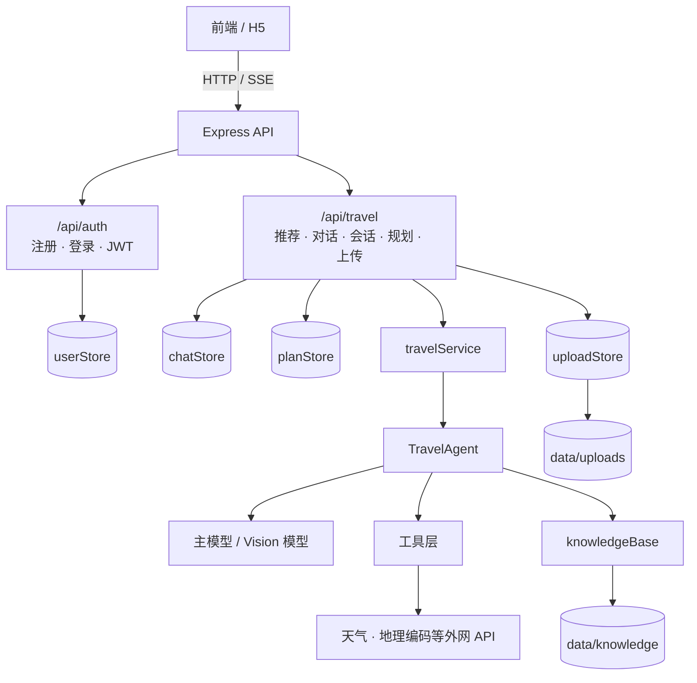
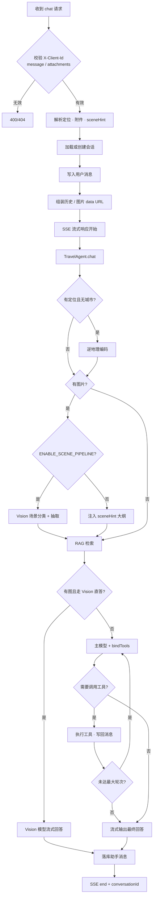
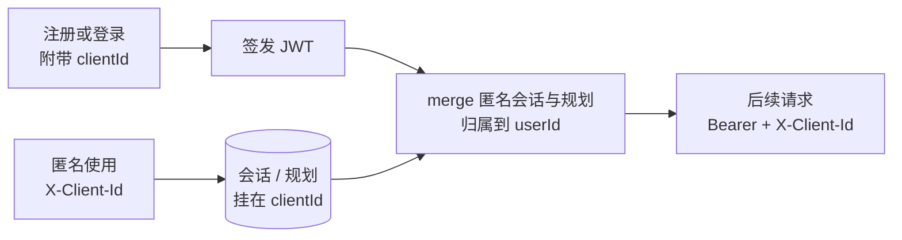

# travel-server

基于 **Express + TypeScript + LangChain** 的旅行推荐后端。对接兼容 OpenAI 协议的大模型（默认硅基流动），使用 **SQLite** 持久化用户、会话、行程与上传图片，并为前端提供行程规划、流式 AI 对话与多模态场景识别能力。

## 功能概览

- **行程推荐**：按城市、预算、天数生成规划并落库，支持「规划记录」查询
- **流式 AI 对话**：TravelAgent + 工具调用 + 本地 RAG 知识库，SSE 流式返回
- **多模态场景**：识景点指示牌、门票/行程单、菜单（Vision 分类与抽取）
- **账号体系**：手机号 / 邮箱注册登录，JWT 鉴权；匿名 `X-Client-Id` 数据可在登录后合并
- **会话管理**：对话创建、重命名、置顶、删除与详情查询
- **图片上传**：JPEG / PNG / WebP，单文件最大 5MB

## 技术栈

| 类别 | 选型 |
|------|------|
| 运行时 | Node.js、Express、TypeScript |
| AI | LangChain、`@langchain/openai`（SiliconFlow 等） |
| 存储 | better-sqlite3 |
| 认证 | JWT、bcryptjs |
| 上传 | multer、image-size |

## 目录结构

```
src/
  agent/         # TravelAgent、工具、场景识别、系统提示词
  db/            # SQLite：用户 / 会话 / 规划 / 上传
  rag/           # 本地知识库检索
  routes/        # auth、travel、recommend（流式规划）
  service/       # 业务编排、LLM、recommendStream
  middleware/    # JWT 鉴权、统一 errorHandler
  utils/         # SSE、上下文窗口、plan JSON 解析、LLM 错误
  index.ts       # 入口
data/
  knowledge/     # RAG 文档（按城市 Markdown）
  uploads/       # 上传图片（运行时）
  *.db           # SQLite 数据文件（运行时）
evals/           # Agent 评测用例
scripts/         # 评测脚本
Dockerfile       # 多阶段构建；entrypoint 首次 seed 知识库
```

## 流程图

### 系统架构



### 流式对话 `/api/travel/chat`



### 登录合并匿名数据



## 快速开始

### 1. 环境要求

- Node.js 18+
- npm

### 2. 安装与配置

```bash
cp .env.example .env
npm install
```

在 `.env` 中至少配置：

| 变量 | 说明 |
|------|------|
| `PORT` | 服务端口，默认 `5000` |
| `MODEL_PROVIDER` | 模型提供方前缀，如 `SILICONFLOW` |
| `SILICONFLOW_API_KEY` | API Key |
| `SILICONFLOW_BASE_URL` | 兼容 OpenAI 的 Base URL |
| `SILICONFLOW_MODEL` | 主对话模型 |
| `SILICONFLOW_VISION_MODEL` | 多模态 / Vision 模型（需支持视觉） |
| `JWT_SECRET` | JWT 签名密钥（未设置时 auth 路由不可用） |
| `JWT_EXPIRES_IN` | Token 有效期，默认 `7d` |

可选：

- `ATTACH_IMAGES_TO_CHAT=1`：最终对话轮把原图一并发给主模型（主模型需支持视觉）
- `ENABLE_SCENE_PIPELINE=1`：有图时先跑 Vision「分类 + 抽取」；默认关闭，直接把原图交给 Vision 模型回答

### 3. 启动

```bash
npm run dev          # 开发：tsx watch
npm run build        # 编译到 dist/
npm start            # 生产：node dist/index.js
```

默认地址：`http://localhost:5000`

### 4. 评测

```bash
npm run eval         # EVAL_DRY_TOOLS=1，工具打桩、无需外网
```

## API 一览

### 通用

| 方法 | 路径 | 说明 |
|------|------|------|
| `GET` | `/` | 健康探活文案 |
| `GET` | `/api/heartbeat` | `{ status, timestamp }` |

### 认证 `/api/auth`

| 方法 | 路径 | 说明 |
|------|------|------|
| `POST` | `/register` | 注册（手机号或邮箱，密码 ≥ 6 位） |
| `POST` | `/login` | 登录，返回 JWT；可带 `clientId` 合并匿名数据 |
| `GET` | `/me` | 当前用户（需 Bearer Token） |
| `POST` | `/logout` | 登出（客户端丢弃 Token 即可） |

### 旅行 `/api/travel`

多数接口需要请求头 **`X-Client-Id`**。登录后可额外携带：

```http
Authorization: Bearer <token>
```

| 方法 | 路径 | 说明 |
|------|------|------|
| `POST` | `/recommend` | **SSE** 行程规划（body: `city`, `budget`, `days`） |
| `POST` | `/chat` | **SSE** 流式对话（`message`、`conversationId`、`location`、`attachments`、`sceneHint`） |
| `GET` | `/conversations` | 会话列表 |
| `POST` | `/conversations` | 新建会话 |
| `GET` | `/conversations/:id` | 会话详情（含消息） |
| `PATCH` | `/conversations/:id` | 重命名 / 置顶 |
| `DELETE` | `/conversations/:id` | 删除会话 |
| `GET` | `/plans` | 规划记录列表 |
| `GET` | `/plans/:id` | 规划详情 |
| `DELETE` | `/plans/:id` | 删除规划 |
| `POST` | `/uploads/image` | 上传聊天图片（multipart field: `file`） |
| `GET` | `/uploads/files/:id` | 读取已上传图片 |
| `GET` | `/location/reverse` | 逆地理编码（query: `lat`, `lon`） |

#### 约束

| 接口 | 约束 |
|------|------|
| `/recommend` | `days` 1–30；`budget` ≥ 100；缺字段返回 400 JSON（非 SSE） |
| `/chat` | `message` 与 `attachments` 至少其一；附件最多 3 张，且须属当前 owner |
| `/uploads/image` | JPEG / PNG / WebP；单文件 ≤ 5MB |

#### SSE 约定

两条流式接口均返回 `Content-Type: text/event-stream`，每条事件一行 `data: <json>\n\n`（见 `src/utils/streamUtils.ts`）。设置了 `X-Accel-Buffering: no` 以便反代实时推送。客户端断开时会 `AbortController.abort()` 取消 LLM。

**`POST /recommend` 事件**（实现：`src/routes/recommend.ts` + `recommendStream.ts`）：

| `type` | 含义 |
|--------|------|
| `stage` | 心跳 / 阶段，内容多为 `"generating"`（约每 3s） |
| `meta` | 部分解析出的 `{ city, days, totalBudget }` |
| `day` | 某一天行程（按 day 号去重推送） |
| `budget` | 预算拆分 |
| `done` | 完整规划 JSON；若带了 `X-Client-Id` 会落库并带上 `id` |
| `error` | 失败；可能含 `code`（如 `RATE_LIMITED`、`PARSE_FAILED`）与 `retryAfter` |

**`POST /chat` 事件**：`chunk`（增量文本）→ `done`（含 `conversationId`、完整 `content`、上下文 `usage`）或 `error`。

#### 对话场景 Hint

`sceneHint` 可选值：

- `spot_sign` — 景点指示牌
- `ticket_itinerary` — 门票 / 行程单
- `food_menu` — 菜单

默认有图时把原图交给 Vision 模型直答；仅当 `ENABLE_SCENE_PIPELINE=1` 时才走「分类 + 结构化抽取」再注入上下文。

## Agent 与工具

对话由 `TravelAgent` 编排，最多多轮工具调用，内置工具包括：

| 工具 | 作用 |
|------|------|
| `get_weather` | 查询天气 |
| `geocode_location` | 地理编码 |
| `search_attractions` | 景点检索（结合本地知识库） |
| `search_travel_guides` | 攻略检索（结合本地知识库） |

知识库文档位于 `data/knowledge/`（Markdown + frontmatter：`city` / `type` / `tags`）。

## 上下文窗口（Token 预算）

对话在进入 Agent 前会走 `prepareChatContext`：

1. **启发式 Token 估算**（中英混合，见 `src/utils/tokenCounter.ts`）
2. **滑动窗口**：从最新消息向前填满输入预算
3. **摘要压缩**（默认开启）：被滑出的旧消息经 LLM 压成短摘要再注入

相关环境变量见 `.env.example`（`CONTEXT_MAX_TOKENS` 等）。SSE `done` 事件的 `content.usage` 会带回估算统计。

## Docker

本仓库仅含后端镜像（无 `docker-compose.yml`）。知识库在镜像内作为 `knowledge-seed`；命名卷首次挂载空的 `/app/data/knowledge` 时，`docker-entrypoint.sh` 会拷贝 seed。

```bash
# 构建
docker build -t travel-server .

# 运行（持久化 SQLite / 上传 / 知识库）
docker run --rm -p 5000:5000 \
  --env-file .env \
  -v travel-server-data:/app/data \
  travel-server
```

健康检查探测 `GET /api/heartbeat`。与前端联调时：H5 镜像的 Nginx 把 `/api/` 反代到主机名 `server:5000`（见 `travel-agent-H5` 的 `nginx.conf`），Compose 中请把本服务命名为 `server`，并为 SSE 关闭缓冲、拉长超时。

## 故障排查

| 现象 | 排查 |
|------|------|
| 注册 / 登录 500 或不可用 | 未设置 `JWT_SECRET`（启动时会打 warn） |
| `/recommend` 立刻 400 JSON | 缺 `city` / `budget` / `days`，尚未进入 SSE |
| 规划 `RATE_LIMITED` | 上游 LLM 限流；事件带 `retryAfter`，前端会倒计时重试 |
| 规划 `PARSE_FAILED` | 模型输出非预期 JSON；重试或检查主模型是否适合结构化输出 |
| 对话无场景抽取 | 默认未开管线；需要时设 `ENABLE_SCENE_PIPELINE=1` 且配置可用的 Vision 模型 |
| Docker 知识库为空 | 确认 volume 首次为空从而触发 seed；或手动挂载 `data/knowledge` |
| better-sqlite3 本地编译失败 | 需本机 Python / make / g++；Docker 构建已在 builder 阶段安装 |

